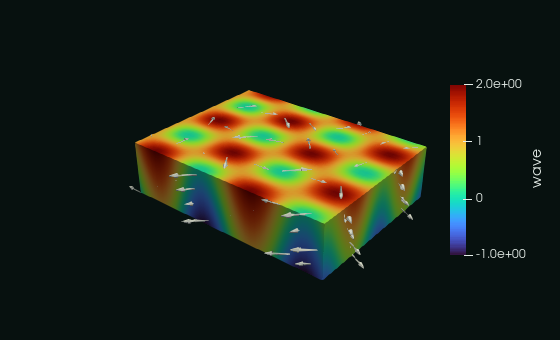

# Formats and large data

How the data are stored: the VTK XML formats, VTKHDF, zlib compression, arrays and meshes beyond the 32-bit limits.
Complete programs:
the [cookbook](/manual/cookbook#choose-the-format) and [chapter 2](/manual/tutorial/02-formats) of the tutorial.

## Output format selection

The `format` argument to `initialize` is case-insensitive:

| Value | Description |
|-------|-------------|
| `ascii` | Text inside XML elements |
| `binary` | Base64-encoded binary inside XML elements |
| `raw` | Raw binary in the appended section |
| `binary-appended` | Base64-encoded binary in the appended section |
| `raw-zlib` | Shorthand for `raw` with `compressor='zlib'`, see [Compressed binary data](#compressed-binary-data-zlib) |
| `vtkhdf` | An HDF5 file in the VTKHDF layout, every topology, HDF5 needed, see [VTKHDF](#vtkhdf-hdf5) |

The binary formats (`binary`, `raw`, `binary-appended`) can be zlib-compressed with `compressor='zlib'`, see
[Compressed binary data](#compressed-binary-data-zlib). Binary arrays larger than 2 GiB need `header_type='UInt64'`, see
[Large data arrays](#large-data-arrays-uint64-headers).

Where the data are, in the two families of formats:

<!--@include: ../diagrams/anatomy.svg-->

The appended formats (`raw`, `raw-zlib`, `binary-appended`) write the XML metadata of each array first and its data only at
`finalize`, in the appended section after all the metadata. Until then the data are held in a **scratch file**, so memory use
does not grow with the file size and the arrays can be deallocated after each `write_dataarray`. The cost is writing the data
once more to the scratch file and reading them back. The scratch file is opened in the temporary directory of the Fortran
runtime: set `TMPDIR` (or `GFORTRAN_TMPDIR` for gfortran, `FORT_TMPDIR` for Intel ifx) to move it to a disk with enough free
space, e.g. off a small `/tmp` on HPC nodes. The `binary` format writes inline, with no scratch file.

## VTKHDF (HDF5)

[VTKHDF](https://docs.vtk.org/en/latest/vtk_file_formats/vtkhdf_file_format/index.html) is the VTK format built on
[HDF5](https://www.hdfgroup.org/solutions/hdf5/): one HDF5 file, whose group `/VTKHDF` holds the dataset as attributes
and one HDF5 dataset per array. VTK's `vtkHDFReader` and ParaView read it; any HDF5 tool (h5py, `h5dump`, HDFView) reads its
arrays directly. It is being added step by step ([issue #51](https://github.com/szaghi/VTKFortran/issues/51)):
every topology is written now (**ImageData**, **RectilinearGrid**, **StructuredGrid**, **UnstructuredGrid** with its
polyhedra, **PolyData**), **Table** (columns of values), **OverlappingAMR** (block-structured AMR), **HyperTreeGrid**
(tree-based AMR), time series in one file, and one file written by MPI ranks.

Choose it when the files are read by HDF5 tools too, or to use HDF5 compression; stay with the XML formats for files
that VTKFortran reads back, and without an HDF5 library. It needs the library built with HDF5 (see
[Installation](/guide/installation#optional-hdf5-vtkhdf)): without it `initialize` returns a non-zero error.

The calls are the ones of the XML formats, with `format='vtkhdf'`; an ImageData:

<<< @/examples/snippets/ref_vtkhdf-write.f90

The file, as an HDF5 tool lists it (the program reads it back with the HDF5 bindings of the library, `vtk_fortran_hdf5`):

<<< @/examples/output/ref_vtkhdf.ansi{ansi}

- **Layout of an ImageData.** `/VTKHDF` has the attributes `Version`, `Type` (`ImageData`), `WholeExtent` (the extent passed to
  `initialize`), `Origin`, `Spacing` and `Direction`, and the groups `PointData`, `CellData` and `FieldData`, one HDF5
  dataset per array, in the order written. The arrays have the type of their kind (`R8P` a 64-bit float, `I4P` a 32-bit
  integer, ...).
- **RectilinearGrid and StructuredGrid** (VTKHDF 2.7): `Type`, and `Dimensions`, the points along x, y and z (no extent,
  origin or spacing: the extent of a grid that does not start at 0 is not kept, the coordinates or points carry the
  geometry). A RectilinearGrid has the datasets `XCoordinates`, `YCoordinates` and `ZCoordinates` (`write_geo(x, y,
  z)`), a StructuredGrid the dataset `Points` of shape `[nz+1, ny+1, nx+1, 3]` (from any of its `write_geo` layouts;
  always 4D, even for a 2D grid, as VTK requires). Arrays as for an ImageData. **They need VTK 9.7**: ParaView 6.1 (VTK
  9.6) reads neither type. A complete program:
  [A grid in a .vtkhdf file](/manual/cookbook#a-grid-in-a-vtkhdf-file).
- **UnstructuredGrid** (`Type` `UnstructuredGrid`, no extent, origin or spacing): each piece is a partition. Its counts
  are one entry of `NumberOfPoints`, `NumberOfCells` and `NumberOfConnectivityIds` (64-bit integers), and its `Points`
  (shape `[np, 3]`, the kind given to `write_geo`), `Connectivity`, `Offsets`, `Types` (8-bit unsigned) and point and
  cell data follow those of the previous pieces in datasets shared by all the pieces. Point ids count from 0 in each
  piece; `Offsets` has `nc+1` values per piece, from 0 (VTKFortran's offsets, the ends of the cells, are converted).
  Ids and offsets keep the kind of the call: `I4P` a 32-bit integer, `I8P` a 64-bit one. Every piece must write the
  same point and cell arrays: an array missing from a piece, or new after the first one, is refused. A complete
  program: [Write a .vtkhdf file](/manual/cookbook#write-a-vtkhdf-file).
- **Polyhedra** (VTKHDF 2.5): the `face` and `faceoffset` of `write_connectivity` become `FaceConnectivity` (the point
  ids of each face), `FaceOffsets` (from 0 in each piece), `PolyhedronToFaces` (the faces of each polyhedron, from 0 in
  the piece) and `PolyhedronOffsets` (one per cell plus one, from 0: a cell that is not a polyhedron has no faces),
  with the counts `NumberOfFaces`, `NumberOfFaceConnectivityIds` and `NumberOfPolyhedronToFaceIds` of each piece. Once a
  file has polyhedra every piece has these entries, zeros for a piece without polyhedra. The faces are checked before
  anything is written: a cell is a polyhedron (type 42) if and only if its `faceoffset` is not `-1`, each face has at
  least 3 points, and the faces of a cell end at its `faceoffset`. The writer stores each face of each polyhedron, a
  face shared by two polyhedra twice: valid in every 2.x version. The reader also reads the shared faces of VTKHDF 2.9
  (stored once, `-(n+1)` for the face `n` traversed in reverse), see [Reading](/guide/reading#vtkhdf-files).
- **PolyData** (`Type` `PolyData`): each piece is a partition too, with its entry of `NumberOfPoints` and its `Points`.
  Its cells are in four groups, `Vertices`, `Lines`, `Strips` and `Polygons`, the blocks of `write_polydata_cells`:
  each group has its own `NumberOfCells`, `NumberOfConnectivityIds`, `Connectivity` and `Offsets` (from 0 in each
  piece), one entry per piece. A block not given has no cells: its group gets zero entries for the piece (the four
  groups are always written, VTK reads none without all of them). A piece of points only needs no
  `write_polydata_cells`. Each block keeps the kind of its ids (I4P or I8P; I8P when its connectivity and its offsets
  differ). Cell data follow the order of the blocks, as in the XML formats. A complete program:
  [A PolyData in a .vtkhdf file](/manual/cookbook#a-polydata-in-a-vtkhdf-file).
- **Table** (`mesh_topology='Table'`, VTKHDF 2.8, a VTK `vtkTable`): columns of values, no mesh and no pieces. The
  columns are written between `write_dataarray(location='row', action='open')` and `action='close'`, each a
  `write_dataarray(data_name, x)` of any kind (or `write_dataarray_unsigned`), with components as a data array: the
  dataset `RowData/<name>` of shape `[rows, components]`. Every column has the same rows (checked), written in
  `NumberOfRows`. In a time series each step writes the same columns, its rows appended (`NumberOfRows` one entry per
  step, `Steps/RowDataOffsets/<name>` where each column starts: the spelling VTK writes and reads, the specification page
  spells it `RowDataOffets`); the file is valid after each step. Refused: a column with other rows, a column missing in a
  step or new after the first one, a step without columns, pieces, point and cell data, `comm`; the XML formats refuse a
  Table (VTK's XML table format, `.vtt`, is not written by VTKFortran). **VTK 9.7 reads it, ParaView 6.1 does not** (its
  VTK 9.6 does not know the type). A complete program: [A time history (Table)](/manual/cookbook#a-time-history-table).
- **OverlappingAMR** (`mesh_topology='OverlappingAMR'`, `origin` of `initialize` its origin, a VTK
  `vtkOverlappingAMR`): the levels of a block-structured AMR, each of uniform boxes. `write_level(level, spacing)` starts
  a level (0, 1, ... in order; a level can be started again, with its spacing), then each box is a piece,
  `write_piece(nx1, nx2, ny1, ny2, nz1, nz2)` (its point extent, in the indices of its level) with its point and cell
  data, closed by `write_piece()`. The layout (measured on what VTK 9.7.2 reads; its `vtkHDFWriter` does not write an
  OverlappingAMR): `/VTKHDF` with `Origin` and `GridDescription` (`XYZ`), a group `Level<n>` per level with `Spacing`,
  `AMRBox` (one row per box, its cells `nx1, nx2-1, ny1, ny2-1, nz1, nz2-1`) and the arrays of its boxes one after the
  other in `PointData` and `CellData` (x fastest in a box, `[n]` or `[n, components]`). A box has at least one cell
  along every axis (VTK reads every box in 3D: a 2D AMR is one cell thick); a box of a finer level lies inside the bounds
  of the boxes of level 0, which come first; every box of every level writes the same arrays. In a time series every
  step writes its levels and boxes again (`Steps/Level<n>/AMRBoxOffset`, `NumberOfAMRBox`, `PointDataOffset/<name>`,
  `CellDataOffset/<name>`: the names VTK 9.7.2 reads, singular, while the specification page writes them plural), the
  file valid after each box. Refused: field data, `comm`, a step without boxes, the XML formats. Read back level by level
  (`get_levels`, `set_level`), see [Reading](/guide/reading#vtkhdf-files). **VTK 9.7 reads it** (its pipeline time too);
  **ParaView 6.1 does not** (its reader groups the output with a filter that refuses an OverlappingAMR). A complete
  program: [A block-structured AMR](/manual/cookbook#a-block-structured-amr).
- **HyperTreeGrid** (`mesh_topology='HyperTreeGrid'`, the extent `nx1`...`nz2` the points of its root grid,
  `branch_factor` of `initialize` 2 (default) or 3, VTKHDF 2.4, a VTK `vtkHyperTreeGrid`): a tree (quadtree, octree, or
  their branch-factor-3 kin) in each root cell. One piece, `write_piece(nx1, ..., nz2)` (the whole extent); its root
  coordinates `write_geo(x, y, z)` (as a RectilinearGrid); each tree `write_tree(tree_id, descriptor, mask)`: `tree_id`
  its root cell (`i + (nx-1)(j + (ny-1)k)`, from 0), `descriptor` the refinement (true) of its cells breadth first, the
  children of a cell x fastest, every depth but the deepest (whose cells are all leaves; an empty descriptor is one
  leaf), `mask` (optional) one value per cell, a refined cell not masked; then its cell data, one value per cell of the
  trees, in the order of the trees written and breadth first in each; `write_piece()`. The layout, as VTK 9.7.2 writes
  it: `Dimensions`, `BranchFactor`, `XCoordinates`..., `Descriptors` and `Mask` (bits packed MSB first, contiguous across
  the trees), `DescriptorsSize` (bits), `TreeIds`, `DepthPerTree`, `NumberOfCellsPerTreeDepth`, `NumberOfTrees`,
  `NumberOfDepths`, `NumberOfCells`, `CellData`. Checked: each descriptor against its depths, the mask, the tree ids
  (in the root grid, once), the size of the cell data. Refused: point data, field data, a time series, `comm`, the XML
  formats; the reader of the library does not read it (error 3). VTK 9.7.2 reads it; ParaView 6.1.1 reads it too, but
  not the test's grid with a masked leaf and a root cell without tree (nor the same grid as VTK 9.7.2 writes it). A
  complete program: [A tree-based AMR](/manual/cookbook#a-tree-based-amr).
- **Time series** (`Steps`): each output starts with `xml_writer%write_step(time)`; the pieces of every step are
  appended to the same datasets, a grid's arrays get a time axis (`[t, k, j, i]` in C order), and the group `Steps` holds
  the times and, for each step, where it starts in the datasets (`PartOffsets`, `PointOffsets`, ...,
  `PointDataOffsets/<name>` and `CellDataOffsets/<name>` for every array, in tuples, in time slices for a grid). What a
  step does not write (the mesh, in a step without pieces; the geometry of a grid; an array) is stored once, the step
  repeating the offsets of the step before. The file is valid after every piece; `action='append'` continues it (a
  refused one, e.g. of a file that is not a time series, leaves the file as it was). See
  [One VTKHDF file instead of a collection](/guide/parallel#one-vtkhdf-file-instead-of-a-collection), whose diagram
  shows the layout.
- **From MPI ranks** (`initialize(..., comm=)`, the library built with `VTKFORTRAN_USE_MPI` and a parallel HDF5): the
  ranks of the communicator write one UnstructuredGrid or PolyData file, the piece of each rank a partition, in rank
  order. The file is the one the pieces would make written by one process, but for the kind of the ids: a dataset gets
  the widest kind the ranks give (a PolyData block a rank does not have is 64-bit, so its ids are 64-bit unless every
  rank gives every block in `I4P`). An ImageData, RectilinearGrid or StructuredGrid is written by regions: each rank
  gives its sub-extent to `write_piece` and the arrays (and coordinates or points) of that region; the datasets are
  created with the whole extent and each rank writes its block, the points of a boundary shared with the next region
  left to that region, the coordinates of a RectilinearGrid shared by regions written by the lowest rank (they must be
  equal). The regions must lie inside the whole extent, not overlap in cells and cover it (checked when they start, on
  every rank); an empty region (an upper bound before its lower one) writes nothing. The file is the one the whole grid
  written by one process makes. Every call is collective (same calls, same arrays, same order on every rank); the
  writes of the ranks are independent (MPI-IO). A time series of an UnstructuredGrid or a PolyData too: every rank
  calls `write_step` with the same time and writes its piece of each step (or, in a step without pieces, the arrays of
  its part of the mesh reused); the `Steps` entries are the totals of the ranks, written once; `action='append'` with
  `comm` continues it. Polyhedra too, on any ranks (the others write zero entries), and compression (`compressor='zlib'`,
  an HDF5 1.10.2 or later with the deflate filter: the writes are then collective). Refused with `comm`: a time series
  of a grid, compression of a grid. Complete
  programs: [Write one .vtkhdf from MPI ranks](/manual/cookbook#write-one-vtkhdf-from-mpi-ranks).
- **No transposition.** An array is stored as it is in memory (an ImageData, RectilinearGrid or StructuredGrid): a
  Fortran `velocity(3,0:nx,0:ny,0:nz)` is the dataset of shape `[nz+1, ny+1, nx+1, 3]` in C order (the order HDF5 tools
  show), which is the shape VTKHDF wants. Point data have the shape of the grid points, cell data of the cells; the
  components of a vector are the last dimension (C order). The axes of one point (a 2D or 1D grid) are dropped, as VTK
  writes them: a `nx+1` by `ny+1` grid has arrays of shape `[ny+1, nx+1]`.
- **ImageData, RectilinearGrid, StructuredGrid: one piece**, whose extent is the whole extent: `write_piece` is called
  once, with the extents of `initialize`; the piece of a RectilinearGrid or StructuredGrid needs its `write_geo`.
- **Data arrays**: every kind, rank and layout of `write_dataarray`, and `write_dataarray_unsigned` (HDF5 unsigned types).
  An array whose size does not match the grid or the piece is refused. Active arrays (`scalars=`, `vectors=`, ...,
  `global_ids=`, ..., `process_ids=`: every role of VTK) become the `Attribute` attribute of their dataset; field data are numeric only: a string is refused (VTK 9.7 crashes
  on string field data, or drops them). See [Data arrays](/guide/data).
- **Compression**: `compressor='zlib'` deflates every dataset (level 6, in chunks of up to 1 MiB). It needs the deflate
  filter of the HDF5 library, not `VTKFORTRAN_USE_ZLIB`: without it `initialize` returns a non-zero error.
- **Version**: the lowest one with the features written: 2.0, 2.5 with polyhedra, 2.6 when an active array is
  designated, 2.7 for a RectilinearGrid or StructuredGrid, 2.8 for a Table, 2.2 for an OverlappingAMR time series, 2.4
  for a HyperTreeGrid. The
  files are checked with VTK 9.7.2 and ParaView 6.1.1 (but the RectilinearGrid, StructuredGrid, Table and
  OverlappingAMR files, which ParaView 6.1 cannot read).
- **Not supported**: more than one piece of a grid (ImageData, RectilinearGrid, StructuredGrid), a volatile
  file (`is_volatile`), VTKHDF pieces in parallel (`P*`) and `.pvd` files (a multi-block file is `vtm_file` with
  `format='vtkhdf'`, a `MultiBlockDataSet` or a `PartitionedDataSetCollection`, static or a time series of
  UnstructuredGrid and PolyData blocks, see
  [Multi-block in one VTKHDF file](/guide/parallel#multi-block-in-one-vtkhdf-file); a VTKHDF file is
  read back with `action='read'`, see [Reading](/guide/reading#vtkhdf-files)). Names: a data name (point, cell, field
  data) or a block name of a multi-block file empty or containing `/` or `.` is refused, never renamed (VTKHDF names
  are HDF5 link names; the XML formats accept them). Each refusal is a non-zero error with a message on standard
  error. `header_type` is ignored: HDF5 has no
  size limit per array.

## Compressed binary data (zlib)

The binary formats can compress their data with zlib, as VTK and ParaView do (`vtkZLibDataCompressor`). Select the
compressor when initializing the file:

<<< @/examples/snippets/ref_formats-zlib.f90

| `format` | with `compressor='zlib'` |
|----------|--------------------------|
| `binary` | compressed data, base64-encoded inside each `DataArray` |
| `raw` | compressed data, raw in the appended section (the same as `format='raw-zlib'`) |
| `binary-appended` | compressed data, base64-encoded in the appended section |
| `ascii` | the compressor is ignored: ASCII data are never compressed |

- `compressor` is `'none'` (default) or `'zlib'`, case insensitive. Any other value makes `initialize` return a non-zero
  error, and so does `format='raw-zlib'` with `compressor='none'`.
- zlib must be enabled when the library is built (`VTKFORTRAN_USE_ZLIB`, see
  [Installation](/guide/installation#optional-zlib-compression)). Without it, `compressor='zlib'` and `raw-zlib` make
  `initialize` return a non-zero error: check it to fall back to an uncompressed format.
- The compression applies to every DataArray of the file: points, connectivity, point, cell and field data. The file
  declares `compressor="vtkZLibDataCompressor"` in its `VTKFile` element. Parallel (`P*`), multi-block and `.pvd` files
  contain no binary data: each piece selects its own compressor.
- Each array is split into blocks of 32 KiB, each compressed independently (zlib level 6), and is preceded by a header with
  the number of blocks, the block size, the size of the last partial block and the compressed size of each block. The
  header words are UInt32 or UInt64, as the `header_type` of the file. With base64, VTK encodes the header and the
  compressed blocks as two separate base64 streams, and so does VTKFortran: the encoded arrays are byte-identical to the
  output of VTK's own writer with the same compression level.
- How much the files shrink depends on the data: integer arrays (connectivity, offsets, cell types, ids) and fields with
  repeated values compress well, generic floating point fields much less. Measure on your own data.
- The cost is CPU time, and memory: while an array is written, its bytes are copied and compressed into temporary buffers
  that together take up to about twice the size of the array.
- With `header_type='UInt32'`, the 2 GiB limit applies to the uncompressed size of each array, as without compression.

## Large data arrays (UInt64 headers)

In the binary formats (`binary`, `raw`, `raw-zlib`, `binary-appended`) each DataArray is prefixed by its size in bytes (by
the header of its compressed blocks, when compressed). By
default the prefix is a 32-bit integer (`header_type="UInt32"`), which limits **each DataArray to 2 GiB**: for example a
3-component `R8P` field of more than about 89 million points. A larger array stops the execution with an explicit error that
suggests the fix. Select 64-bit prefixes when initializing the file:

<<< @/examples/snippets/ref_formats-uint64.f90

- `header_type` is `'UInt32'` (default) or `'UInt64'`, case insensitive; any other value makes `initialize` return a
  non-zero error. It applies to the whole file, so choose it before writing any array; the ASCII format ignores it.
- With `'UInt64'` the file declares `header_type="UInt64"` and the size prefixes (and, for compressed data, the compressed
  blocks headers) are 8 bytes wide, as written by VTK itself; ParaView and VTK read these files.
- The default keeps the files exactly as before. Parallel (`P*`) and multi-block files contain no binary data: their pieces
  select their own header type.
- The number of elements of an array is not limited to 32 bits: an array can hold more than 2^31 values (e.g. the
  connectivity of more than about 270 million hexahedra) in every format, provided its bytes fit the header type.
- The limit concerns the bytes of a single array; for pieces with more than 2^31-1 points or cells, see
  [Large meshes](#large-meshes-64-bit-counts-and-connectivity).

## Large meshes (64-bit counts and connectivity)

A piece with more than 2^31-1 points or cells, or whose point ids exceed `huge(1_I4P)`, needs 64-bit counts and ids. The
mesh procedures accept `I8P` arguments: the kind passed selects the version, so existing `I4P` calls are unchanged.

<<< @/examples/snippets/ref_formats-i8p.f90

<<< @/examples/snippets/ref_formats-i8p-write.f90

| Procedure | 64-bit version |
|-----------|----------------|
| `write_piece(np, nc)` | `np`, `nc` as `I8P` |
| `write_piece(np, nverts, nlines, nstrips, npolys)` | all counts as `I8P` |
| `write_geo(np, nc, x, y, z)`, `write_geo(np, nc, xyz)` | `np`, `nc` as `I8P` |
| `write_connectivity(nc, connectivity, offset, cell_type, face, faceoffset)` | `nc`, ids, offsets and faces as `I8P`; `cell_type` stays `I1P` |
| `write_polydata_cells(...)` | the arrays of each block as `I8P` (each block can use `I4P` or `I8P`) |

- `I8P` connectivity, offsets and faces are written as `Int64`, as VTK's own writer does; `I4P` ones as `Int32`. Readers
  accept both, and the mesh is the same.
- Counts and ids can be mixed: e.g. `I4P` counts in `write_piece` with `I8P` connectivity.
- An array with more than 2^31 elements works in either kind (e.g. an `I4P` connectivity of more than about 270 million
  hexahedra); its bytes must fit the header type (`header_type='UInt64'` beyond 2 GiB).
- The extents of structured grids (`RectilinearGrid`, `StructuredGrid`, `ImageData`) stay 32-bit per axis.
- The test `src/tests/vtk_fortran_write_i8p.f90` writes the same meshes with both kinds, in every format.
