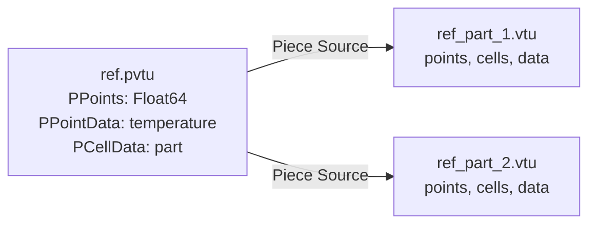
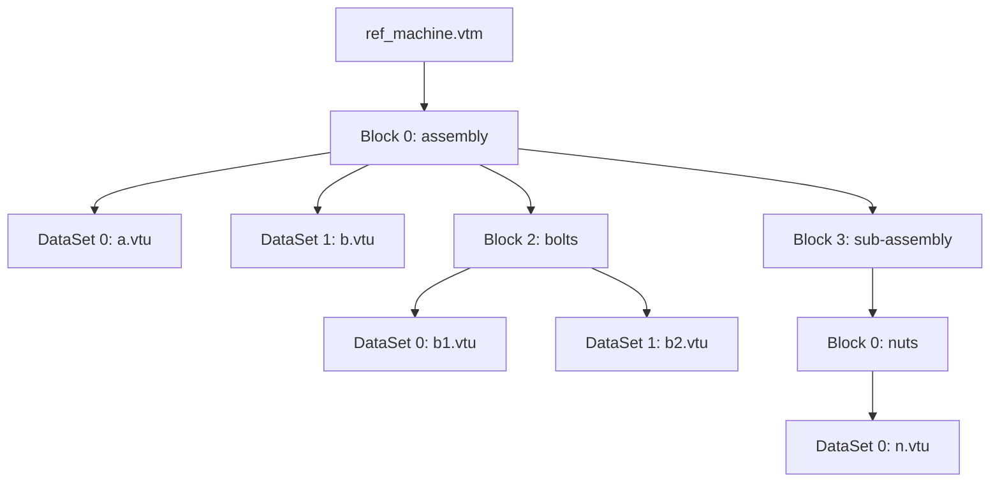
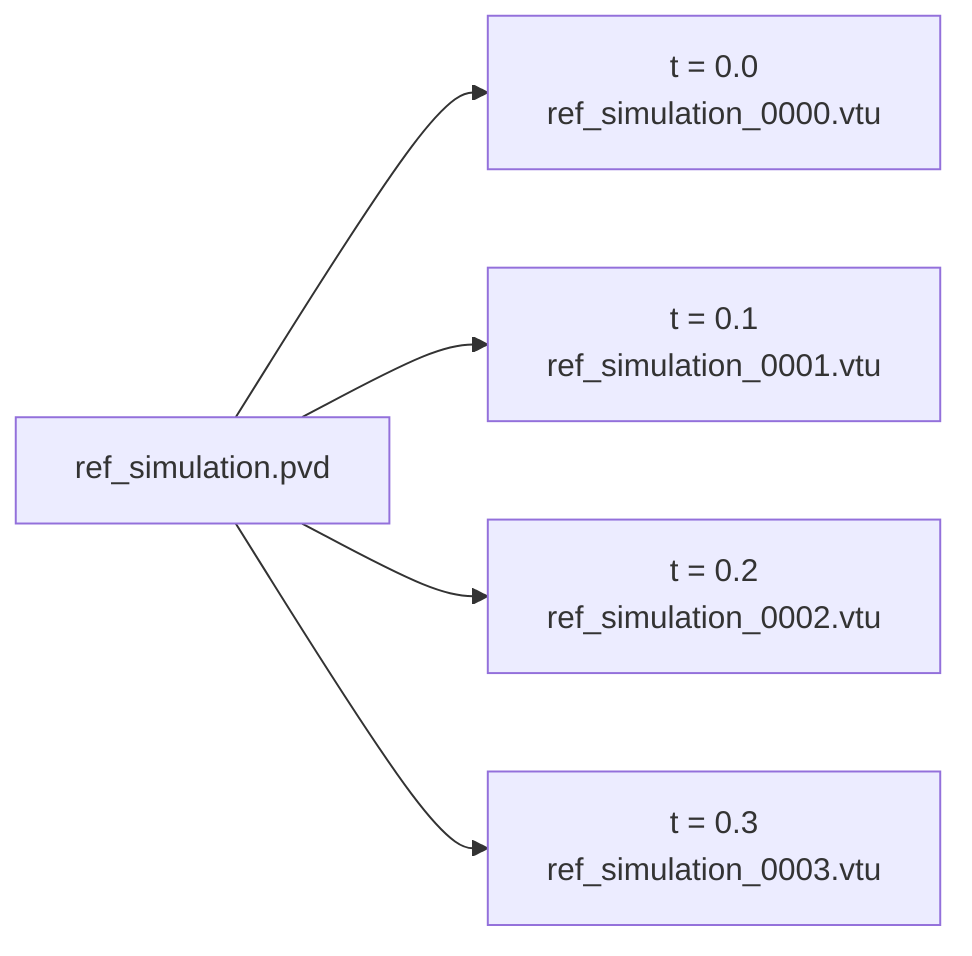

# Parallel and composite files

Files that list other files: parallel (partitioned) headers, multi-block assemblies, time series; files written into
memory. Complete programs: the [cookbook](/manual/cookbook#parallel-and-composite-files) and chapters
[4](/manual/tutorial/04-time-series), [6](/manual/tutorial/06-parallel) and [7](/manual/tutorial/07-assembly) of the tutorial.
The examples of this page are taken from
[`ref_parallel.f90`](https://github.com/szaghi/VTKFortran/tree/master/docs/examples/src/ref_parallel.f90), compiled and run
with the documentation; every parallel header it writes is read back and checked against its pieces.

## Parallel Structured Grid (PVTS)

For MPI-parallel codes, each rank writes its own partition as a regular VTS file, then a single PVTS header file references
all partitions. The program below writes both from one process; the cookbook has the same with real MPI ranks,
[Write from MPI ranks](/manual/cookbook#write-from-mpi-ranks).

<<< @/examples/snippets/ref_parallel-pvts.f90

::: tip Adjacent partition extents
Adjacent pieces must share the boundary ordinate: `nx2_p(1)` of piece 1 must equal `nx1_p(2)` of piece 2. This is required for correct rendering in ParaView.
:::

<!--@include: ../diagrams/pieces.svg-->

## Parallel Rectilinear Grid (PVTR)

A `.pvtr` header is written as a `.pvts` one, with `mesh_topology='PRectilinearGrid'`: each piece is a regular `.vtr` file
holding the coordinates of its own extent, and the header declares the coordinates type through `mesh_kind` (written as
`PCoordinates`). The test `src/tests/vtk_fortran_write_pvtr.f90` is a complete example with point and cell data.

<<< @/examples/snippets/ref_parallel-pvtr.f90

## Parallel Unstructured Grid (PVTU)

The same approach works for unstructured grids: each rank writes its partition as a complete `.vtu` file, with its own points
and a connectivity using **local** point ids (`0` to `np-1` of that piece), then one rank writes the `.pvtu` file. The `.pvtu`
file contains no data: it declares the type of the points coordinates (`mesh_kind`) and of every data array of the pieces, and
lists the pieces. Unstructured pieces have no extents, so `write_parallel_geo` takes only the piece file name.



<<< @/examples/snippets/ref_parallel-pvtu.f90

The names, types and numbers of components declared in the `.pvtu` file must match the data arrays written in every piece
(a string array is declared with `data_type='String'`, written as a `PArray` as VTK writes it): `check_pieces` verifies it, see [Parallel headers](/guide/reading#parallel-headers). See `src/tests/vtk_fortran_write_pvtu.f90` for the
complete program, pieces included.

### Ghost cells

When each piece also carries layers of the cells of its neighbours (the ghost cells a solver keeps to compute its own),
declare their number in the header with the `ghost_level` argument of `initialize` (default 0), written as the
`GhostLevel` attribute, and mark the ghost cells of each piece with the unsigned array `vtkGhostType` (1 for a ghost cell,
see [Unsigned integer arrays](/guide/data#unsigned-integer-arrays)), declared in the header too. The header of
[chapter 6](/manual/tutorial/06-parallel) of the tutorial:

<<< @/examples/snippets/heat_6-header.f90

Readers then skip the ghost cells when they draw the dataset, so the cells shared by two pieces are not drawn twice.

## Parallel Image Data (PVTI)

Each rank writes its piece as a `.vti` file with the **same** `origin` and `spacing` of the whole grid and the extents of the
piece (adjacent pieces share the boundary index, as for PVTS); one rank writes the `.pvti` file with the whole extents, the
same `origin` and `spacing`, and the extents of each piece. `mesh_kind` is not needed: image pieces have no points coordinates.

<<< @/examples/snippets/ref_parallel-pvti.f90

See `src/tests/vtk_fortran_write_vti.f90` for a complete program, serial and parallel.

## Parallel Polygonal Data (PVTP)

As for PVTU: each rank writes its piece as a complete `.vtp` file (local point ids), one rank writes the `.pvtp` file with the
type of the points coordinates (`mesh_kind`, required) and of each data array, and the list of the pieces:

<<< @/examples/snippets/ref_parallel-pvtp.f90

See `src/tests/vtk_fortran_write_vtp.f90` for a complete program with the four blocks, serial and parallel.

## Parallel Table (PVTT)

The pieces of a Table are `.vtt` files (`mesh_topology='Table'`, see [Table](/guide/topologies#table)); the `.pvtt` header declares its
columns between `write_dataarray(location='row', action='open')` and `action='close'` (`PRowData`; a string column with
`data_type='String'`, a `PArray`) and lists the pieces with `write_parallel_geo(source=...)`:

<<< @/examples/snippets/ref_parallel-pvtt.f90

VTK 9.7.2's `vtkXMLPTableReader` reads one piece per request (`UpdatePiece`), not the whole table, and gives its string
columns empty: the same with a `.pvtt` VTK writes. The test `src/tests/vtk_fortran_read_composite.f90` writes one and
reads it back (`check_pieces`), as this page's program does.

## Multi-block Dataset (VTM)

A VTM file is a composite wrapper that references multiple individual VTK files organised into named blocks.

<<< @/examples/snippets/ref_parallel-vtm.f90

### Nested blocks

Blocks can contain both datasets and other blocks, to any depth, e.g. to mirror the parts and assemblies of a CAD model.
Build the hierarchy step by step with the `action` argument of `write_block`:

| Call | Effect |
|------|--------|
| `write_block(action='open', name=...)` | open a child block of the current block (or a top-level block) |
| `write_block(filenames=[...], names=[...], action='write')` | write the files as datasets of the current block |
| `write_block(filenames=[...], names=[...], name=...)` | write the files wrapped in a new child block |
| `write_block(action='close')` | close the current block |

An empty file name is an empty dataset (VTK's null block): `<DataSet index="..." file=""/>` in a `.vtm`, read back by VTK
as an empty block; in a VTKHDF multi-block file a group `Block_<n>` without attributes, linked as the others (named after
`names`, `Block_<n>` otherwise; outside the time series rules); refused in a VTKHDF collection, which VTK 9.7.2 then
cannot read. `vtm_file` reading gives an empty dataset an empty `file`.

<<< @/examples/snippets/ref_parallel-vtm-nested.f90



- The children of a block (blocks and datasets together) get the indexes 0, 1, 2, … in the order they are written, as VTK
  numbers the children of a multi-block dataset. Every `action='open'` needs its `action='close'`.
- The string form (`filenames='a.vtu b.vtu'`, names separated by blanks) accepts the same `action` values.
- `write_block(filenames=[...], name=..., action='pieces')` wraps the files in a `Piece`: a `vtkMultiPieceDataSet`, the
  partitions of one dataset, as VTK writes them in a `.vtm` (an XML `.vtm` only; the partitioned composites hold their
  partitions as the datasets of a block).
- The test `src/tests/vtk_fortran_write_vtm_nested.f90` writes the hierarchy of issue #25, checked with VTK's reader.

### Multi-block in one VTKHDF file

With `format='vtkhdf'` (the library built with HDF5), `vtm_file` writes one VTKHDF file, a `MultiBlockDataSet`, with
the same `write_block` calls: each dataset, a `.vtkhdf` file written by `vtk_file`, is copied into it (the group
`Block_<n>` of `/VTKHDF`), and the tree of the blocks is the group `Assembly`, whose groups are the blocks and whose soft
links, named after the datasets (`names`, or the file names without directory and extension), point to the copies; the
names of a block must differ. The copied files can be deleted afterwards. `scratch` units are refused (the blocks are
written in order). A block is a single dataset: a composite file (a multi-block file or a collection) or an
OverlappingAMR is refused as its source (the blocks of a composite are not composite, VTKHDF specification; VTK 9.7.2
crashes on a composite copied in, and reads the multi-block without an OverlappingAMR block). `src/tests/vtk_fortran_write_vtkhdf_vtm.f90` writes the nested assembly above in VTKHDF.

**A PartitionedDataSetCollection.** With `initialize(..., format='vtkhdf', composite='PartitionedDataSetCollection')`
the file is VTK's other composite (`vtkPartitionedDataSetCollection`, VTKHDF 2.1), written by the same `write_block`
calls. The two compared:

| | `MultiBlockDataSet` (default) | `PartitionedDataSetCollection` |
|---|---|---|
| Copy of a dataset | the group `Block_<n>` | the group of its name, with the attribute `Index` (0, 1, ... as written) |
| A dataset in two blocks | copied twice, or copied once and placed in other blocks with `references` (its name must be unique) | copied once, then placed in other blocks with `write_block(references='name ...')` |
| Dataset names | unique in a block | unique in the file (a second one is refused: reference the first), not `Assembly` |
| VTK output | `vtkMultiBlockDataSet`, the blocks nested | `vtkPartitionedDataSetCollection`, flat, the tree in its `vtkDataAssembly` |

`references` is an argument of the string form of `write_block` (blank separated, as `filenames`), alone
(`write_block(references='pump', name='rotating')`, a new block) or with `action='write'` (the open block): soft links
to the copies, no new copy. In a multi-block file a name given to several datasets cannot be referenced (ambiguous); an
XML `.vtm` refuses `references` (it repeats the file; an XML `.vtpc` takes them, below). VTK 9.7.2 reads a referenced
dataset in each of its blocks. The time series rules below are
the same. ParaView 6.1.1 reads a collection and plays every step; VTK 9.7.2 as for a multi-block file (each step with
`SetStep`). `src/tests/vtk_fortran_write_vtkhdf_vtm.f90` writes the nested assembly and a time series as collections,
each with a block referencing two datasets already copied, and a multi-block file referencing two datasets.

**XML partitioned composites.** Without `format='vtkhdf'`, `composite='PartitionedDataSetCollection'` writes VTK's
XML collection, a `.vtpc`, with the same calls: each dataset (one file) a `<Partitions name=...>` written once, the
blocks the nodes of its `vtkDataAssembly` (stored base64 in `<DataAssembly>`, as VTK writes it; a block name must be an
XML element name), `references` placing a dataset in other blocks, an empty file name an empty dataset.
`composite='PartitionedDataSet'` writes a `.vtpd`, a flat list of partitions: `write_block(filenames=[...],
action='write')`, no blocks (refused, as `format='vtkhdf'`: a `.vtkhdf` has partitions of its own). VTK 9.7.2 and
ParaView read both; `vtm_file` reads them back (`get_entries`).

**A time series of several meshes.** The blocks can be time series (`write_step`), so that one file holds several
meshes moving together: see [A time series of several meshes in one .vtkhdf file](/manual/cookbook#a-time-series-of-several-meshes-in-one-vtkhdf-file).

- A file is **either static or a time series**: its first block decides, and a block of the other kind is refused
  (VTK cannot read the mix, VTK issue 19963). Make a fixed part a time series too, the same mesh at every step.
- Every block has **the same steps**: their number and their times, compared exactly (the specification requires it).
  A block with other steps is refused, the message naming the first step that differs.
- The time-series blocks are of any type but a **Table** (VTK 9.7.2 reads a Table-series block without rows): an
  UnstructuredGrid or PolyData of one or more parts per step, an ImageData, RectilinearGrid, StructuredGrid or
  HyperTreeGrid.
- **Readers**: ParaView 6.1.1 plays every step of every block (it reads no RectilinearGrid nor StructuredGrid VTKHDF
  file, a block or not). VTK 9.7.2 reads each step with `vtkHDFReader::SetStep` called before the first update; its
  pipeline time (`UpdateTimeStep`), or `SetStep` after `UpdateInformation`, leaves an UnstructuredGrid or PolyData
  block at the first step and a grid block without its arrays, VTK's own multi-block files too (a single dataset
  follows it).
- A refused file leaves the block opened for it by `write_block` open, as a missing file does: `finalize` then returns
  an error.

**Reading it back.** `vtm_file%initialize(filename, action='read')` lists the blocks and datasets of a VTKHDF
multi-block file or collection (`get_entries`: the groups of its `Assembly` and the links in them, in the order
written); the `file` of a dataset is its group under `/VTKHDF`, which `vtk_file%initialize(filename, action='read',
dataset=file)` reads as a `.vtkhdf` of its own, steps included. See [Reading](/guide/reading#multi-block-and-time-series-files).

### Blocks filled in any order

When the files of the blocks are known one at a time, interleaved (e.g. a solver that writes, at each output, one file
per part of its model), give each block a **scratch unit**: `initialize` with `scratch_units_number`, then `write_block`
with the number of the unit (`scratch`) to open the block (`action='open'`, its `name`) and to add each of its files
(`action='write'`, one `filename` per call). The files are kept in the scratch units, and `finalize` writes the blocks, in
the order of their units:

<<< @/examples/snippets/ref_parallel-vtm-scratch.f90

<<< @/examples/output/ref_parallel-series.ansi{ansi}

- The blocks are written at the top level, one per unit, and the name of each dataset is its file name.
- It can be mixed with the other forms: the blocks written with them come first, the scratch blocks follow at `finalize`.

## Time series (PVD)

A `.pvd` file is a *collection*: it lists the files of a simulation (any VTK XML file written by `vtk_file`, `pvtk_file` or
`vtm_file`) with their time, and ParaView loads them as a single time series. Write each time step as usual, then add it to the
collection with `pvd_file`:

<<< @/examples/snippets/ref_parallel-pvd.f90

writes

<<< @/examples/output/ref_parallel-pvd.ansi{ansi}



ParaView opens the collection as one dataset with a time axis: each time step shows the file listed for it.

- **The file is valid at any time.** Each `write_dataset` writes its entry and the closing tags, and flushes the file: a run
  that stops before `finalize` (crash, job killed by the scheduler) still leaves a collection that ParaView opens, with all the
  steps written so far.
- **Restart.** `pvd%initialize(filename='simulation.pvd', action='append')` reopens an existing collection and adds the new
  steps after the ones already listed (the default `action='new'` replaces the file). The file must exist and be a collection,
  otherwise `initialize` returns a non-zero error. Anything after the closing tags of the reopened file (e.g. a comment
  added by hand) is overwritten with blanks.
- **Optional attributes.** `write_dataset` also accepts `part` (default `0`; e.g. the rank, when each process writes its own
  file per step), `group` and `name`.
- `timestep` is a `real(R8P)`, written with the shortest representation that reads back exactly. `filename` is written as
  given: relative paths are relative to the directory of the `.pvd` file.

**A ParaView file series.** A file name ending in `.series` (e.g. `simulation.vtu.series`: ParaView picks the reader
of the files by the extension before `.series`) writes ParaView's JSON file series instead, with the same calls, valid
after each `write_dataset` and continued with `action='append'` as well:

```json
{
  "file-series-version" : "1.0",
  "files" : [
    { "name" : "simulation_0000.vtu", "time" : 0.0000000000000000E+000 },
    { "name" : "simulation_0001.vtu", "time" : 1.0000000000000001E-001 }
  ]
}
```

It lists files and times only: `part`, `group` and `name` are refused. The times are written with 17 digits (they read
back exactly). ParaView 6.1.1 reads it as the `.pvd`.

See `src/tests/vtk_fortran_write_pvd.f90` for a complete program, restart and `.series` included.

### One VTKHDF file instead of a collection

The VTKHDF format holds a whole time series in one HDF5 file: with `format='vtkhdf'`, each output starts with
`xml_writer%write_step(time)`, followed by its field data and its pieces, written with the usual calls; the group `Steps`
of the file tells where each step starts in the datasets that the steps share. A complete program:
[A time series in one .vtkhdf file](/manual/cookbook#a-time-series-in-one-vtkhdf-file).

<!--@include: ../diagrams/vtkhdf.svg-->

| | `.pvd` collection | one `.vtkhdf` |
|---|---|---|
| Files | one per step, any XML format, plus the collection | one |
| Valid during the run | after every step | after every piece |
| Restart | `pvd_file%initialize(..., action='append')` | `vtk_file%initialize(format='vtkhdf', ..., action='append')` |
| Steps | any time, any order | increasing times; the arrays of the first step |
| What does not change | written again in every file | stored once: the offsets of the step before repeated |
| Reading back with VTKFortran | yes | yes, step by step (`set_step`) |

- `action='append'` reads the state of the series from the file (topology, extent, steps, parts, arrays and where each
  one was last written) and drops what an interrupted run left after its last complete piece; the next `write_step`
  needs a later time.
- **What does not change is stored once**: a step repeats the offsets of the step before for what it does not write,
  as the diagram shows for the mesh of step 3 ([A fixed mesh stored once](/manual/cookbook#a-fixed-mesh-stored-once)):
  - **the mesh** of an UnstructuredGrid or a PolyData: a step after the first one without pieces (`write_step`, then
    its data groups opened directly with `write_dataarray(location=..., action='open')`) reuses all the parts of the
    step before; its arrays hold the points (cells) of all those parts, in their order;
  - **the geometry** of a RectilinearGrid or StructuredGrid: a piece without `write_geo` reuses the coordinates or
    points of the step before (an ImageData has none);
  - **an array** not written in a step reuses its values of the step before: in a step of a grid (with or without its
    piece) and in a step without pieces. A step with pieces writes every point and cell array, since its parts can
    differ from those the values were written for. A field data array not written reuses its values too.

  The first step writes everything, and an array first written at a later step is refused. The files are read by VTK
  9.7.2 and ParaView 6.1.1 as if every step were written in full (checked step by step against the XML files of the
  same steps). Point and cell data offsets (`PointDataOffsets`, `CellDataOffsets`) are written for every array: tuples,
  time slices for a grid.
- VTK 9.7.2 reads two kinds of series wrongly, in the files of its own writer too: a PolyData block of cells (lines,
  say) that first appears at a later step is read empty at that step; a series of one part at its first step is read as
  one dataset, of which a later step with more parts keeps only the last. Write every block from the first step (empty
  blocks are fine afterwards), and the largest number of parts at the first step, or use a `.pvd` collection.

## Threads and processes

**MPI processes** write their own files at the same time with no limitation: they share no memory. Each rank writes its
piece, one rank the header, see [Write from MPI ranks](/manual/cookbook#write-from-mpi-ranks).
With a parallel HDF5 the ranks can also write **one** `.vtkhdf` file together, each rank a partition of it (or a
region of a grid), no header, time series included: see
[Write one .vtkhdf from MPI ranks](/manual/cookbook#write-one-vtkhdf-from-mpi-ranks).

**OpenMP threads** writing (or reading) different files at the same time is a matter of the compiler that builds the
library. VTKFortran and its dependencies keep the state of each file in its own `vtk_file` and share no variable that
changes while files are written, but for the constant tables of PENF and BeFoR64, filled by the first `initialize`:
initialize one file (or call `penf_init` and `b64_init`) before the parallel region. Some compilers add shared variables
of their own:

| Compiler | Files from threads |
|----------|--------------------|
| Intel ifx 2025.3 | ✅ the library (and its dependencies) built with `-recursive`: the CMake and FoBiS builds add it |
| NVIDIA nvfortran 26.9 | ✅ the library (and its dependencies) built with `-mp`, which locks the input/output statements only in code built so: the CMake build adds it, to the link of the programs that use the library too (they link the OpenMP runtime) |
| GNU gfortran, up to 16.2 | ❌ the length of a function result of deferred-length character (`character(len=:), allocatable`) is a static variable, shared by the threads ([GCC bug 113797](https://gcc.gnu.org/bugzilla/show_bug.cgi?id=113797)); gfortran 14 and 15 also make static every variable of a type with user-defined input/output, as the strings of StringiFor. The files are corrupted, or the program crashes: write the files from one thread, or from MPI processes |

The test `src/tests/vtk_fortran_write_openmp.f90` writes 8 files from 4 threads, in every format, compares them byte by
byte with the same files written serially, and reads them back from the threads, 25 times over: a race shows only now and
then. CMake runs it with `-DVTKFORTRAN_TEST_OPENMP=ON`, e.g. `cmake -S . -B build -DBUILD_TESTING=ON
-DVTKFORTRAN_TEST_OPENMP=ON -DCMAKE_Fortran_COMPILER=ifx`: it passes 20 runs out of 20 with ifx and nvfortran, and fails
with gfortran. With other builds (fpm, your own build system) add `-recursive` (ifx) or `-mp` (nvfortran) to the flags of
the library and of its dependencies, e.g. `fpm build --flag -recursive`.

::: warning Appended formats from threads, up to 3.0.1
Up to 3.0.1 the appended formats (`raw`, `raw-zlib`, `binary-appended`) closed their scratch file twice. A unit number,
once closed, can be given to a file opened by another thread, which the second close then closed: about one run in 60
of the test failed, more under load, with the other thread looping on a read error (and writing it without end). The
writer now closes it once, and stops on any read error. Older versions: write the appended formats from one thread, or
use `binary`.
:::

## Volatile XML output

In some parallel setups only one process (the master) can access the file system. The other processes can write their files
into memory instead: initialize the file with `is_volatile=.true.`, write it as usual, then get its content as a string,
send it to the master, which writes it to disk with `write_xml_volatile`.

<<< @/examples/snippets/ref_parallel-volatile.f90

- The `binary` and `ascii` formats support volatile files. The appended formats (`raw`, `raw-zlib`, `binary-appended`)
  write their data to the file directly: with `is_volatile=.true.`, `initialize` returns a non-zero error.
- The string is the exact content of the file: written by the master, it is identical to the file written directly (the
  test `src/tests/vtk_fortran_write_volatile.f90` checks it).
