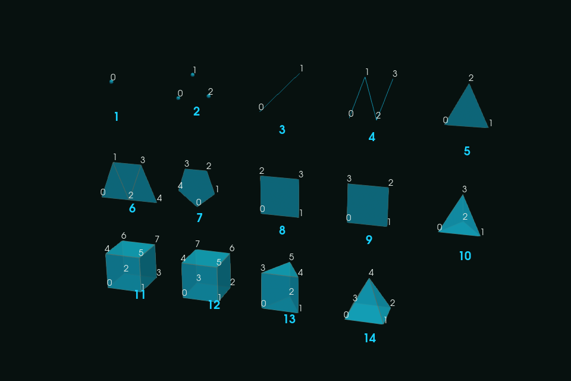

# Topologies

Write each kind of VTK XML dataset: the serial topologies, several pieces in one file. Complete programs: the
[cookbook](/manual/cookbook#write-each-kind-of-dataset) and the [tutorial](/manual/tutorial/01-first-file).

The examples of this page are taken from
[`ref_topologies.f90`](https://github.com/szaghi/VTKFortran/tree/master/docs/examples/src/ref_topologies.f90), compiled
and run with the documentation; every file it writes is read back. The general workflow for writing a VTK XML file is:

1. **Initialize** — open the file and select the format and mesh topology
2. **Write field data** *(optional)* — attach global metadata (time, cycle, etc.)
3. **Open a piece** — declare the extent or node/cell counts for the current piece
4. **Write geometry** — coordinates (and connectivity for unstructured grids)
5. **Write data arrays** — node-centered or cell-centered variables
6. **Close the piece**
7. **Finalize** — flush and close the file

Every function returns an integer error status, 0 on success (the subroutines `get_xml_volatile` and `free` take an
optional `error`). Two failures stop the program instead, with a message on standard error: a binary array larger than
the 2 GiB of a UInt32 header (initialize the file with `header_type='UInt64'`), and a failure of zlib while
compressing. To read a file back, see [Reading files](/guide/reading).

## Image Data (VTI)

A regular grid with uniform spacing along each axis needs no geometry at all: it is defined by its extents, the coordinates of
its origin and its spacing. The point of indexes `(i,j,k)` is at `origin + [i,j,k] * spacing` (the origin is the point of
indexes `(0,0,0)`, also when the extents do not start at 0).

<<< @/examples/snippets/ref_topologies-vti.f90

- `origin` and `spacing` are required for `ImageData`: without them `initialize` returns a non-zero error (and no file is
  written).
- `direction` (optional) orients the grid axes, as a row-major 3x3 matrix: the point `(i,j,k)` is at
  `origin + direction . ([i,j,k] * spacing)`. Default: identity.
- `write_geo` is not used. Point data have one value per grid point, cell data one value per cell, written with the usual
  `write_dataarray` calls in any format.
- ImageData is also written in the VTKHDF format (`format='vtkhdf'`, an HDF5 file), with the same calls and one piece:
  see [VTKHDF](/guide/formats#vtkhdf-hdf5). So is every other topology.

## Rectilinear Grid (VTR)

A rectilinear grid has independent 1-D coordinate arrays along each axis.

<<< @/examples/snippets/ref_topologies-vtr.f90

In the VTKHDF format (`format='vtkhdf'`, one piece) the coordinates are the datasets `XCoordinates`, `YCoordinates` and
`ZCoordinates`: see [VTKHDF](/guide/formats#vtkhdf-hdf5).

## Structured Grid (VTS)

A structured grid has full 3-D coordinate arrays — each grid point has its own `(x, y, z)` position.

<<< @/examples/snippets/ref_topologies-vts.f90

Arrays of rank 2 to 4 hold the components in their **first** dimension (see
[Writing arrays](/guide/data#writing-arrays)): without `one_component=.true.`, the rank-3 scalar `v(0:9,0:5,0:5)` would be written as an array of 10 components and 36 tuples instead of 1 component and 360
tuples, a file that readers reject or misread. Pass `one_component=.true.` for every scalar field stored in an array of
rank 2 to 4.

In the VTKHDF format (`format='vtkhdf'`, one piece) the points are the dataset `Points`, from any of the `write_geo`
layouts: see [VTKHDF](/guide/formats#vtkhdf-hdf5) and the recipe
[A grid in a .vtkhdf file](/manual/cookbook#a-grid-in-a-vtkhdf-file).

## Unstructured Grid (VTU)

An unstructured grid requires explicit node coordinates, a connectivity table, cell offsets, and cell types. Here a unit
cube (a hexahedron, points 0 to 7) with a pyramid on top of it (its base is the top face of the cube, its apex the point 8):

<<< @/examples/snippets/ref_topologies-vtu.f90

How the three arrays describe the two cells:

<!--@include: ../diagrams/connectivity.svg-->

Unstructured grids are written in every format, compressed or not, as the other topologies, and in the VTKHDF format
(`format='vtkhdf'`, an HDF5 file) too, with the same calls: each piece is a partition of the file, polyhedra included.
See [VTKHDF](/guide/formats#vtkhdf-hdf5) and the recipe
[Write a .vtkhdf file](/manual/cookbook#write-a-vtkhdf-file).

Cell types are passed as `integer(I1P)` and written as a `UInt8` DataArray, as the VTK XML format specifies (VTK cell type
codes are all below 128, so the bytes are the same).

### Cell types

The VTK codes of the cells, with their number of points. The points of each cell are listed in the order VTK defines for
its type (for the hexahedron: the bottom face counter-clockwise seen from above, then the top face in the same order);
see figures 2 and 3 of the [VTK file formats](https://docs.vtk.org/en/latest/vtk_file_formats/vtk_legacy_file_format.html#dataset-format)
for the drawings, with the order of the points of every type.

| Code | Cell | Points | | Code | Cell | Points |
|-----:|------|-------:|-|-----:|------|-------:|
| 1 | vertex | 1 | | 21 | quadratic edge | 3 |
| 2 | poly-vertex | any | | 22 | quadratic triangle | 6 |
| 3 | line | 2 | | 23 | quadratic quad | 8 |
| 4 | polyline | any | | 24 | quadratic tetrahedron | 10 |
| 5 | triangle | 3 | | 25 | quadratic hexahedron | 20 |
| 6 | triangle strip | any | | 26 | quadratic wedge | 15 |
| 7 | polygon | any | | 27 | quadratic pyramid | 13 |
| 8 | pixel | 4 | | 28 | bi-quadratic quad | 9 |
| 9 | quad | 4 | | 29 | tri-quadratic hexahedron | 27 |
| 10 | tetrahedron | 4 | | 42 | polyhedron | any, see below |
| 11 | voxel | 8 | | | | |
| 12 | hexahedron | 8 | | | | |
| 13 | wedge | 6 | | | | |
| 14 | pyramid | 5 | | | | |

Pixels and voxels are the axis-aligned quad and hexahedron, with their points in the order `i`, then `j`, then `k`: not
the order of the quad and hexahedron.

The linear cells, each labelled with its code and its points with their position in the connectivity of the cell, as
written by [`ref_cells.f90`](https://github.com/szaghi/VTKFortran/tree/master/docs/examples/src/ref_cells.f90) (every
cell checked by VTK's cell validator):

### Polyhedron cells

General polyhedra (VTK cell type `42`) need two more arrays, passed to `write_connectivity` as the optional `face` and
`faceoffset` arguments:

- `face`: for each polyhedron, the number of its faces followed, for each face, by the number of its points and the point
  ids, listed counter-clockwise seen from outside the cell (the normal of each face points out: VTK flags a face listed
  the other way as a wrong orientation);
- `faceoffset`: for each cell, the position in `face` where the description of that cell ends, or `-1` if the cell is not a
  polyhedron.

The `connectivity` of a polyhedron lists the (unique) ids of its points, as for any other cell. For example, a unit cube written
as a polyhedron (points `0`–`7`) followed by a tetrahedron (points `8`–`11`):

<<< @/examples/snippets/ref_topologies-polyhedron.f90

See `src/tests/vtk_fortran_write_vtu_polyhedron.f90` for the complete program. The same calls write the polyhedra in the
VTKHDF format (`format='vtkhdf'`, VTKHDF 2.5), as the faces and the faces of each polyhedron: see
[VTKHDF](/guide/formats#vtkhdf-hdf5).

## Polygonal Data (VTP)

PolyData describe points and up to four blocks of cells: **vertices**, **lines** (polylines), **triangle strips** and
**polygons**, typical of surfaces, curves and point clouds. Open the piece with the number of points and of cells of each block,
write the points with `write_geo`, then the blocks with `write_polydata_cells`:

<<< @/examples/snippets/ref_topologies-vtp.f90

- Each block is a pair of arrays, as in `write_connectivity`: the point ids (0-based) of its cells one after the other, and the
  cumulative offset of the end of each cell. Pass only the blocks you have; a block with only one of its two arrays is an
  error. The number of cells of each block must match the counts given to `write_piece`.
- **Cell data follow the VTK order of the blocks**: vertices, then lines, then strips, then polygons, whatever the order of the
  arguments.
- The `nc` argument of `write_geo` is not used for PolyData (it writes the points only).
- PolyData are written in the VTKHDF format (`format='vtkhdf'`, an HDF5 file) too, with the same calls: each piece is a
  partition of the file, each block a group. See [VTKHDF](/guide/formats#vtkhdf-hdf5) and the recipe
  [A PolyData in a .vtkhdf file](/manual/cookbook#a-polydata-in-a-vtkhdf-file).

## Table

A Table holds columns of values, with no mesh: time histories, probes, integrals (a VTK `vtkTable`). It is written
(`mesh_topology='Table'`) as a `.vtt` in the XML formats, which ParaView opens, or as a VTKHDF file
(`format='vtkhdf'`), with the same calls: its columns between `write_dataarray(location='row', action='open')` and
`action='close'`, every column of the same rows:

<<< @/examples/snippets/vtkhdf_table-history.f90

- A column is any `write_dataarray` (every kind, components as for a data array) or `write_dataarray_unsigned`.
- A `.vtt` has one `Piece` with `NumberOfCols` and `NumberOfRows`, written at the close of the columns (they are
  kept in memory until then), and the columns in `RowData`. A time series of `.vtt` files is a `.pvd`.
- In a VTKHDF time series (`write_step(time)` before each output) every step writes the same columns, with any number
  of rows.
- No pieces and no point or cell data. The layouts, the refusals and the readers: [VTKHDF](/guide/formats#vtkhdf-hdf5);
  complete programs: [A time history (Table)](/manual/cookbook#a-time-history-table).

## OverlappingAMR (VTKHDF)

A block-structured AMR (a VTK `vtkOverlappingAMR`): levels of uniform boxes, each finer level of a smaller spacing,
its boxes overlapping those of the levels before. It is written in the VTKHDF format only (`format='vtkhdf'`,
`mesh_topology='OverlappingAMR'`, `origin` its origin): `write_level(level, spacing)` starts a level, then each box is a
piece of it, its point extent in the indices of the level, with its point and cell data:

<<< @/examples/snippets/vtkhdf_amr-write.f90

- Levels 0, 1, ... in order; the boxes of level 0 come first (they bound the boxes of the finer levels).
- A box has at least one cell along every axis: VTK reads every box in 3D, so a 2D AMR is one cell thick.
- Every box of every level writes the same arrays; no field data. In a time series every step writes its levels and
  boxes again.
- The layout, the refusals and the readers: [VTKHDF](/guide/formats#vtkhdf-hdf5); a complete program:
  [A block-structured AMR](/manual/cookbook#a-block-structured-amr).

## HyperTreeGrid (VTKHDF)

A tree-based AMR (a VTK `vtkHyperTreeGrid`): a root grid whose cells are the roots of trees, quadtrees or octrees (branch
factor 2) or their kin of branch factor 3. It is written in the VTKHDF format only (`format='vtkhdf'`,
`mesh_topology='HyperTreeGrid'`, the extent the points of the root grid, `branch_factor`): one piece with its root
coordinates, its trees (`write_tree`, each the refinement of its cells breadth first) and their cell data:

<<< @/examples/snippets/vtkhdf_htg-write.f90

- A tree is given breadth first, the children of a cell x fastest, every depth but the deepest (its cells are all
  leaves); a mask can hide leaves.
- Cell data only, one value per cell of the trees, after the trees, in their order.
- In a time series (`write_step` before each output) every step writes its piece: coordinates, trees, cell data.
- The layout, the refusals and the readers: [VTKHDF](/guide/formats#vtkhdf-hdf5); a complete program:
  [A tree-based AMR](/manual/cookbook#a-tree-based-amr).

## Multiple pieces in one file

A single file can hold several pieces, e.g. the blocks of a multi-block solver written by one process without a parallel
header: open and close each piece with `write_piece`, and write its geometry, connectivity and data in between, exactly as
for a single-piece file. Readers (VTK, ParaView) merge the pieces into one dataset.

<<< @/examples/snippets/ref_topologies-pieces.f90

- Each piece has its own points: the point ids of its connectivity (and offsets) are local to the piece, starting from 0.
- Every piece must carry the same data arrays (same names, types and components): VTK takes the arrays of the first piece,
  so an array missing in the first piece is dropped, and one missing in a later piece is silently filled with zeros there.
- For structured topologies (`RectilinearGrid`, `StructuredGrid`, `ImageData`), `initialize` sets the whole extent and each
  `write_piece(nx1=..., nx2=..., ...)` sets the extent of the piece inside it; adjacent pieces share their boundary plane.
- It works with every format; the test `src/tests/vtk_fortran_write_multipiece.f90` writes both kinds of grids.

## Coordinates (`write_geo`)

Every topology but `ImageData` stores its points; `write_geo` takes them in the form of the topology. The coordinates are
`R8P` (written as `Float64`) or `R4P` (`Float32`).

| Topology | Call | Coordinates |
|----------|------|-------------|
| `RectilinearGrid` | `write_geo(x, y, z)` | rank 1: the coordinates along each axis, `nx2-nx1+1`, `ny2-ny1+1`, `nz2-nz1+1` values |
| `StructuredGrid` | `write_geo(n, x, y, z)` | rank 1 `x(n)` or rank 3 `x(i,j,k)`: `n` points, `i` varying first |
| `StructuredGrid` | `write_geo(xyz)` | rank 2 `xyz(3,n)` or rank 4 `xyz(3,i,j,k)` |
| `UnstructuredGrid`, `PolyData` | `write_geo(np, nc, x, y, z)` | rank 1 `x(np)`; `np` and `nc` `I4P` or `I8P` |
| `UnstructuredGrid`, `PolyData` | `write_geo(np, nc, xyz)` | rank 2 `xyz(3,np)` |
| `ImageData` | none | `origin`, `spacing` and `direction` of `initialize` |

The packed forms, from `ref_topologies.f90`:

<<< @/examples/snippets/ref_topologies-geo-packed.f90

<<< @/examples/snippets/ref_topologies-geo-packed-structured.f90

<<< @/examples/snippets/ref_topologies-geo-packed-unstructured.f90

A count that does not match the size of the arrays (`n`, `np`) makes `write_geo` return 1, with nothing written.

## Errors

Every function returns an integer status: 0 on success, otherwise the file is not complete and the status says why.

| Status | Cause |
|--------|-------|
| 1 | an argument is invalid: `initialize` with an unknown `format`, `header_type`, `compressor` or `action`, without `format` or `mesh_topology`, `format='raw-zlib'` with `compressor='none'`, `compressor='zlib'` with a library built without zlib, `is_volatile=.true.` with an appended format, `ImageData` without `origin` and `spacing`; a parallel header (`pvtk_file`) of points without `mesh_kind`; `write_geo` with counts that do not match the arrays; `write_polydata_cells` with a block given only one of its two arrays; `write_dataarray_unsigned` of an `I8P` value of `2^63` or more in ASCII |
| other positive values | an input/output statement failed (opening, writing, closing the file: a missing directory, no permission, a full disk): the `iostat` of the compiler |

Two failures stop the program instead (`error stop`, with a message on standard error): a binary array larger than the
2 GiB of a UInt32 header (initialize the file with `header_type='UInt64'`, see
[Large data arrays](/guide/formats#large-data-arrays-uint64-headers)), and a failure of zlib while compressing. The
readers have codes of their own, see [Reading files](/guide/reading#serial-files). `vtm_file` and `pvd_file` return 1
for an unknown `action` or a file that cannot be appended to, and the `iostat` of a failed input/output statement.

## Mesh topology strings

The `mesh_topology` argument is case-sensitive:

| Value | Produces |
|-------|---------|
| `ImageData` | `.vti` file (requires `origin` and `spacing`) |
| `RectilinearGrid` | `.vtr` file |
| `StructuredGrid` | `.vts` file |
| `UnstructuredGrid` | `.vtu` file |
| `PolyData` | `.vtp` file |
| `Table` | `.vtt` (XML formats) or `.vtkhdf` (`format='vtkhdf'`) |
| `OverlappingAMR` | `.vtkhdf` file only (`format='vtkhdf'`, `origin`) |
| `HyperTreeGrid` | `.vtkhdf` file only (`format='vtkhdf'`, `branch_factor`) |
| `PRectilinearGrid` | `.pvtr` file (pvtk_file only) |
| `PStructuredGrid` | `.pvts` file (pvtk_file only) |
| `PUnstructuredGrid` | `.pvtu` file (pvtk_file only) |
| `PImageData` | `.pvti` file (pvtk_file only, requires `origin` and `spacing`) |
| `PPolyData` | `.pvtp` file (pvtk_file only) |
