# Cookbook

Short answers to "how do I ...?". Each recipe is a complete program with its real output; the
[reference](/guide/features) has the details, the [tutorial](./tutorial/01-first-file) the whole story.

[[toc]]

## Write each kind of dataset

### A regular grid (ImageData)

No coordinates at all: the points are defined by the extent, an origin and a spacing.

<<< @/examples/snippets/image_data.f90

<<< @/examples/output/image_data.ansi{ansi}

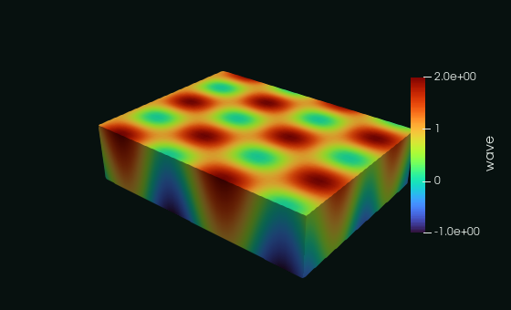

`direction` (a row-major 3x3 matrix) rotates the axes of the grid. In a parallel `.pvti`, every piece has the same origin
and spacing.

### A curvilinear grid (StructuredGrid)

Every point has its own coordinates, the topology is still that of a box: `write_geo(n, x, y, z)` with rank-3 arrays.

<<< @/examples/snippets/curvilinear.f90

<<< @/examples/output/curvilinear.ansi{ansi}

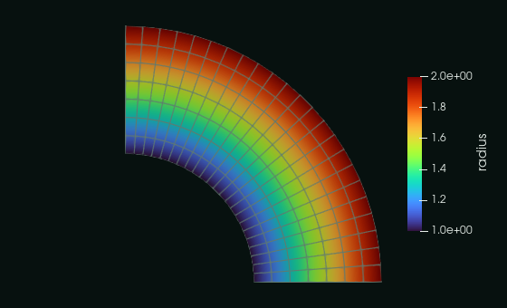

### Cells of any type, polyhedra included (UnstructuredGrid)

`cell_type` gives the VTK type of each cell, `offset` the end of each cell in `connect`. A polyhedron (type 42) also needs
its faces: `face` and `faceoffset`, `-1` for the cells that are not polyhedra; the points of each face are listed
counter-clockwise seen from outside the cell.

<<< @/examples/snippets/polyhedron.f90

<<< @/examples/output/polyhedron.ansi{ansi}

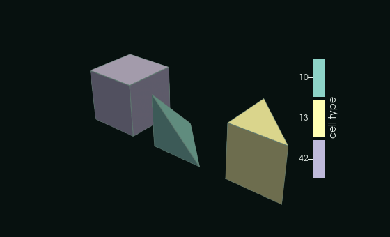

### Points, lines and polygons (PolyData)

Up to four blocks of cells: vertices, lines (polylines), triangle strips, polygons. Pass only the blocks you have.

<<< @/examples/snippets/polydata.f90

<<< @/examples/output/polydata.ansi{ansi}

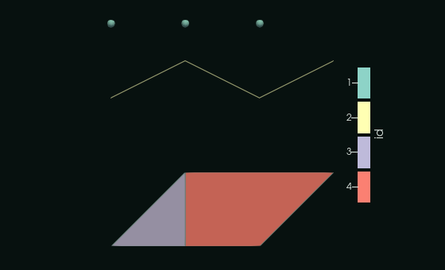

The cell data follow the VTK order of the blocks: vertices, lines, strips, polygons.

## Write data

### Scalars, vectors and tensors

A vector by its components, `x`, `y`, `z`; any number of components as a rank-2 array `(components, points)`: 6 for a
symmetric tensor (xx, yy, zz, xy, yz, xz), 9 for a full one.

<<< @/examples/snippets/vectors_tensors.f90

<<< @/examples/output/vectors_tensors-inspect.ansi{ansi}

`scalars`, `vectors` and `tensors` choose the arrays readers use by default. `inspect` is the program of the
[quick start](/#quick-start).

### Time, cycle and other global data

<<< @/examples/snippets/field_data.f90

<<< @/examples/output/field_data.ansi{ansi}

Field data are written right after `initialize`, before the first piece: scalars and rank-1 arrays of any kind, strings and
arrays of strings (trailing blanks trimmed).

### Ghost cells and other unsigned arrays

<<< @/examples/snippets/ghost_cells.f90

<<< @/examples/output/ghost_cells.ansi{ansi}

`write_dataarray_unsigned` writes `I1P`...`I8P` arrays as `UInt8`...`UInt64`. In `vtkGhostType`, `1` marks a duplicate cell
and `32` a hidden one: ParaView does not draw them. For partitions (one piece per rank), the duplicated boundary points
are ghosts and global ids (`global_ids=` when opening the point or cell data) tell VTK which points are the same:
[Partitions, ghosts and global ids](/guide/data#partitions-ghosts-and-global-ids).

## Choose the format

### Compress, and go beyond 2 GiB

<<< @/examples/snippets/compress.f90

<<< @/examples/output/compress.ansi{ansi}

`compressor='zlib'` needs the library built with zlib: `initialize` returns an error otherwise, the time to fall back to an
uncompressed format. `header_type='UInt64'` is needed only for arrays of more than 2 GiB. The sizes of each format are
measured in [chapter 2](./tutorial/02-formats) of the tutorial.

### Write a .vtkhdf file

`format='vtkhdf'` writes one HDF5 file in the VTKHDF layout, with the calls of the XML formats: ParaView reads it, and so
does any HDF5 tool. Here three blocks of hexahedra, each one a piece of an UnstructuredGrid:

<<< @/examples/snippets/vtkhdf_pieces-write.f90

Each piece is a partition of the file: its counts are one entry of `NumberOfPoints`, `NumberOfCells` and
`NumberOfConnectivityIds`, its points, cells and arrays follow those of the previous pieces in datasets shared by all.
Point ids count from 0 in each piece, and the offsets start from 0 in each piece, as VTKHDF wants (VTKFortran's offsets
are the ends of the cells: the writer converts them). The program reads the counts back with the HDF5 bindings of the
library:

<<< @/examples/output/vtkhdf_pieces.ansi{ansi}

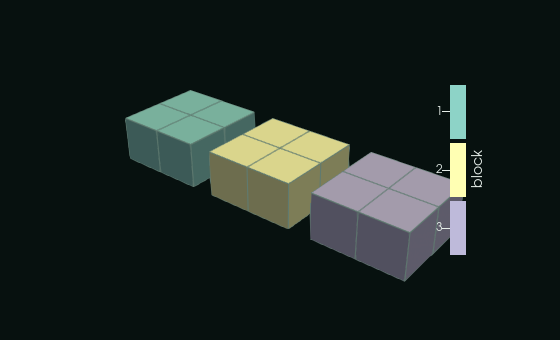

ParaView reads the partitions as one partitioned dataset. Every piece must hold the same arrays: an array missing from a
piece, or new after the first one, is refused. It needs the library built with HDF5 (`initialize` returns an error
otherwise). Every topology is written, polyhedra included; the layout of the file: [VTKHDF](/guide/formats#vtkhdf-hdf5).

### A PolyData in a .vtkhdf file

The calls of a PolyData, with `format='vtkhdf'`: here a hexagon with a vertex on each corner, then a ribbon (a triangle
strip) with a polyline above it, each one a piece.

<<< @/examples/snippets/vtkhdf_polydata-write.f90

Each piece is a partition, and each block of cells a group of the file, with one entry per piece: a block a piece does
not have gets zero cells there. The program reads the counts back with the HDF5 bindings of the library:

<<< @/examples/output/vtkhdf_polydata.ansi{ansi}

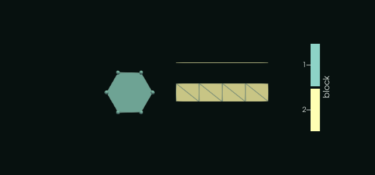

The cell data follow the order of the blocks (vertices, lines, strips, polygons), as in the XML formats.

### A grid in a .vtkhdf file

A StructuredGrid (here a thick quarter of an annulus) takes the calls of the XML formats too, in one piece whose extent
is the whole extent:

<<< @/examples/snippets/vtkhdf_grid-write.f90

The points are one dataset, `Points`, whatever the layout given to `write_geo`; the attribute `Dimensions` holds the
points along each axis. The program prints the layout, read back with the HDF5 bindings of the library:

<<< @/examples/output/vtkhdf_grid.ansi{ansi}

A RectilinearGrid is written the same way, with `write_geo(x=x, y=y, z=z)`: its coordinates are the datasets
`XCoordinates`, `YCoordinates` and `ZCoordinates`. Both are VTKHDF 2.7: **VTK 9.7 reads them, ParaView 6.1 does not**
(its VTK 9.6 knows neither type); use the XML formats (`.vtr`, `.vts`) for a ParaView of VTK 9.6 or older.

### A time series in one .vtkhdf file

Instead of one file per output and a `.pvd` collection, the whole series in one `.vtkhdf` file: each output starts with
`write_step(time)`, then its field data and its pieces, written as usual. Here a wave on a 2D grid, written in two runs:
the second one reopens the file with `action='append'`, as a restarted simulation would.

<<< @/examples/snippets/vtkhdf_series-write.f90

Each output:

<<< @/examples/snippets/vtkhdf_series-output.f90

<<< @/examples/output/vtkhdf_series.ansi{ansi}

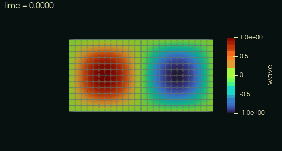

- **The file is valid after every piece**: a run killed in the middle leaves the steps written so far, as a `.pvd`
  collection does. `action='append'` continues the file, and drops what an interrupted run left after its last complete
  piece. The times must increase: a restart from an earlier time is refused.
- The first step writes every array. A grid (ImageData, RectilinearGrid, StructuredGrid) has one piece per step; the
  parts of an UnstructuredGrid or a PolyData can change from step to step, and so can the mesh. What does not change
  is stored once: see the next recipe.
- The layout of the file: [VTKHDF](/guide/formats#vtkhdf-hdf5); the two kinds of series compared:
  [Time series](/guide/parallel#time-series-pvd).

### A fixed mesh stored once

A simulation on a fixed mesh need not write it at every output: after the first step, a step **without pieces**
reuses the mesh of the step before, and writes its arrays only, in data groups opened directly after `write_step`. Here
a plate of quadrilaterals (an UnstructuredGrid) and its temperature, six steps:

<<< @/examples/snippets/vtkhdf_fixed-write.f90

<<< @/examples/snippets/vtkhdf_fixed-temperature.f90

The program writes the same series with the mesh at every step too, and prints what each file stores:

<<< @/examples/output/vtkhdf_fixed.ansi{ansi}

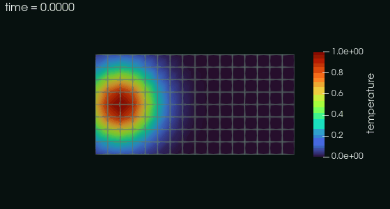

- The offsets of `Steps` repeat those of the step before for what a step does not write: here `PointOffsets` is 0 at
  every step. The arrays of a step without pieces hold the points (cells) of all the parts of the mesh, in their order.
- **An array** not written in a step reuses its values of the step before: in a step of a grid, or in a step without
  pieces; a step with pieces writes every point and cell array. A field data array not written reuses its values too.
- **A grid**: a RectilinearGrid or StructuredGrid piece without `write_geo` reuses the coordinates or points of the
  step before; a step of a grid can also have no piece at all (every array reused).
- `action='append'` keeps reusing after a restart. The rules: [One VTKHDF file instead of a
  collection](/guide/parallel#one-vtkhdf-file-instead-of-a-collection).

### A time series of several meshes in one .vtkhdf file

Several meshes moving together, in one file: each one is written as its own time series, with the same times, then
`vtm_file` with `format='vtkhdf'` copies them as the blocks of one multi-block file. Here a wave (a PolyData surface) and
a buoy riding it (an UnstructuredGrid of two hexahedra), six steps.

<<< @/examples/snippets/vtkhdf_motion-write.f90

The steps of each mesh, written as for a single series:

<<< @/examples/snippets/vtkhdf_motion-steps.f90

<<< @/examples/output/vtkhdf_motion.ansi{ansi}

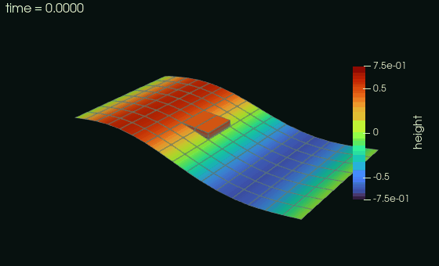

- A file is **either static or a time series**, as its first block: a static block in a time series is refused, as
  the output shows (VTK cannot read the mix). A part that does not move is written as a series too, the same mesh at
  every step.
- Every block has **the same steps**, their number and times; each one an UnstructuredGrid or a PolyData, of any
  number of parts per step. A time-series ImageData, RectilinearGrid or StructuredGrid block is refused: VTK 9.7.2
  reads it without its arrays.
- ParaView 6.1.1 plays every step of every block. The rules and readers in detail:
  [Multi-block in one VTKHDF file](/guide/parallel#multi-block-in-one-vtkhdf-file).

### A time history (Table)

Time histories, probes and integrals are columns of values, without a mesh: a Table. Here the history of a damped
oscillator, one row per time step, written at the end of the run as the columns of one Table:

<<< @/examples/snippets/vtkhdf_table-history.f90

A time series of Tables keeps the rows of each output apart: here three probes of a travelling wave, one row per probe
at each output, the file valid after each step:

<<< @/examples/snippets/vtkhdf_table-probes.f90

Both are read back with the reader of the library, the columns with `location='row'`:

<<< @/examples/snippets/vtkhdf_table-read.f90

<<< @/examples/output/vtkhdf_table.ansi{ansi}

A Table is VTKHDF 2.8: **VTK 9.7 reads it** (`vtkHDFReader` gives a `vtkTable`), **ParaView 6.1 does not** (its VTK
9.6 does not know the type). See [VTKHDF](/guide/formats#vtkhdf-hdf5) for the layout.

### A block-structured AMR

A block-structured AMR in one file, an OverlappingAMR: level 0 covers the domain with one box, level 1 refines two
boxes around a hot spot at half the spacing. Each level starts with `write_level`, each box is a piece of it (its point
extent in the indices of the level), with its arrays:

<<< @/examples/snippets/vtkhdf_amr-write.f90

The file is read back level by level, the boxes of a level as its pieces:

<<< @/examples/snippets/vtkhdf_amr-read.f90

<<< @/examples/output/vtkhdf_amr.ansi{ansi}

**VTK 9.7 reads it** (`vtkHDFReader` gives a `vtkOverlappingAMR`); **ParaView 6.1 does not**: its VTKHDF reader passes
the output to a filter that refuses an OverlappingAMR. See [VTKHDF](/guide/formats#vtkhdf-hdf5) for the layout.

### A tree-based AMR

A tree-based AMR in one file, a HyperTreeGrid: a root grid of 4x2 cells, each the root of a quadtree refined down to
depth 3 around a circle. Each tree is its refinement, breadth first (the deepest depth left out: its cells are all
leaves); the depth of each cell is its cell data:

<<< @/examples/snippets/vtkhdf_htg-write.f90

<<< @/examples/output/vtkhdf_htg.ansi{ansi}

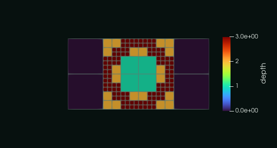

The program builds each tree level by level (the function `tree` of
[`vtkhdf_htg.f90`](https://github.com/szaghi/VTKFortran/tree/master/docs/examples/src/vtkhdf_htg.f90)). VTK 9.7 and
ParaView 6.1 read it. See [VTKHDF](/guide/formats#vtkhdf-hdf5) for the layout.

### More than 2^31 points or cells

<<< @/examples/snippets/ids_64bit.f90

<<< @/examples/output/ids_64bit-grep.ansi{ansi}

The kind of the counts and ids selects the version: `I4P` calls are unchanged.

### Several pieces in one file

<<< @/examples/snippets/pieces_in_file.f90

<<< @/examples/output/pieces_in_file-inspect.ansi{ansi}

Readers merge the pieces into one dataset. Every piece must hold the same arrays.

## Parallel and composite files

### A partitioned structured grid (.pvts)

<<< @/examples/snippets/pvts.f90

<<< @/examples/output/pvts.ansi{ansi}

The same for `.pvtr` (`PRectilinearGrid`) and `.pvti` (`PImageData`, with origin and spacing); unstructured pieces
(`.pvtu`, `.pvtp`) have no extent, see [chapter 6](./tutorial/06-parallel).

### Write from MPI ranks

Each rank writes its own piece, a complete file named after the rank; rank 0 waits for all of them, writes the header
that lists them and checks it. No data move between the ranks: every file is written by one process.

<<< @/examples/snippets/mpi_pieces.f90

<<< @/examples/output/mpi_pieces.ansi{ansi}

Built with the MPI compiler wrapper (`mpifort`) and run with `mpirun -np 4`. When only rank 0 can write to the file
system, the other ranks write their pieces into memory and send them to it, see
[Write a file into memory](#write-a-file-into-memory).

### Write one .vtkhdf from MPI ranks

With a parallel HDF5 the ranks write one file together: `comm` (the Fortran handle of a communicator) given to
`initialize`, every rank makes the same calls, each one with its own piece, which becomes a partition of the file (an
UnstructuredGrid, a PolyData), or its own region of the grid (ImageData, RectilinearGrid, StructuredGrid, below).

<<< @/examples/snippets/vtkhdf_mpi-write.f90

<<< @/examples/output/vtkhdf_mpi.ansi{ansi}

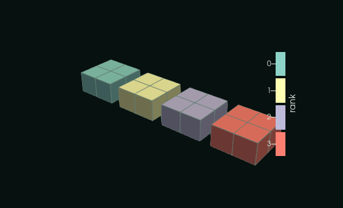

- **Every call is collective**: the ranks create and extend the datasets together, then each one writes its rows after
  those of the ranks before. Every rank calls every procedure, with the same arrays in the same order. Wrong arguments
  on some ranks in a call they all make (a size, a negative count, `face` without `faceoffset`) are refused on every
  rank; but ranks making different calls (one stops calling, or, in a step reusing the mesh, writes an array the others
  do not) cannot be told apart from slow ones: the others wait for it.
- An UnstructuredGrid or a PolyData, one piece per rank; a rank can have an empty piece (`np=0`, `nc=0`). A PolyData
  piece without cells still calls `write_polydata_cells()`, with no blocks.
- Polyhedra (on any ranks: the others write zero entries for their pieces) and `compressor='zlib'` (an HDF5 1.10.2 or
  later with the deflate filter: a deflated dataset needs collective writes, which the ranks then make) are written as
  in serial. Refused with `comm`: a time series of a grid, `compressor='zlib'` for a grid, the XML formats,
  `action='read'`. A refusal comes on every rank, also when only one rank's values are
  wrong (their size, say): the ranks agree on the error before the collective calls, none is left waiting.

A **time series** from the ranks: every rank calls `write_step` with the same time (checked: different times are an
error on every rank), then writes its piece of the step; a step without pieces reuses the mesh of the step before, each
rank writing the arrays of its own part. Here the blocks of the four ranks, the mesh written at the first step only:

<<< @/examples/snippets/vtkhdf_mpi_series-write.f90

<<< @/examples/output/vtkhdf_mpi_series.ansi{ansi}

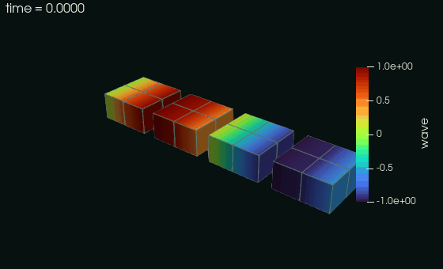

- The `Steps` entries are those of all the ranks: a part per rank in each step (`NumberOfParts`), offsets of the totals
  of the ranks before, written once. A rank's arrays in a step without pieces hold the points (cells) of its own part.
- `initialize(format='vtkhdf', filename=..., action='append', comm=...)` continues the series from the ranks (a parallel
  restart); a step reusing the mesh after it needs the same number of ranks as the parts of the last step.
- A time series of a grid from the ranks is not supported yet (refused).

A grid (ImageData, RectilinearGrid, StructuredGrid) is written by **regions**: `initialize` gets the whole extent,
`write_piece` the region of the rank, and its arrays (and coordinates or points) are those of the region. Here an
ImageData of 8x4 cells, one region of 4x2 cells per rank:

<<< @/examples/snippets/vtkhdf_mpi_grid-write.f90

<<< @/examples/output/vtkhdf_mpi_grid.ansi{ansi}

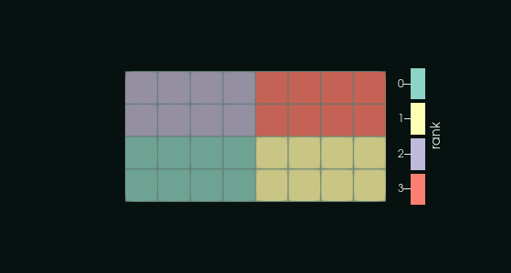

- The regions of all the ranks are checked when they start, on every rank: inside the whole extent, not overlapping
  in cells, covering it. A rank with nothing to write gives an empty region (an upper bound before its lower one) and
  empty arrays.
- Neighbouring regions share the points of their boundary: each rank gives all the points of its region, and the
  boundary is written by the region that starts there. The coordinates of a RectilinearGrid shared by regions must be
  equal; the lowest rank writes them.
- The file is the one the whole grid written by one process would make: VTK and ParaView read it as any ImageData.
- It needs the library built with `VTKFORTRAN_USE_MPI` (CMake `-DVTKFORTRAN_USE_MPI=ON`, FoBiS mode
  `static-gnu-hdf5-mpi`) and a parallel HDF5; `initialize` returns an error otherwise
  ([Installation](/guide/installation#one-file-from-mpi-ranks)). Built with `mpifort`, run with `mpirun -np 4`.

### Check a parallel header against its pieces

<<< @/examples/snippets/check_pieces.f90

<<< @/examples/output/check_pieces.ansi{ansi}

### Continue a time series after a restart

<<< @/examples/snippets/pvd_append.f90

<<< @/examples/output/pvd_append.ansi{ansi}

The collection is valid after every `write_dataset`: a job killed before `finalize` leaves a readable series.

### Assemblies of datasets (.vtm)

Blocks nested to any depth, read back with `get_entries`: see [chapter 7](./tutorial/07-assembly).

### Write a file into memory

<<< @/examples/snippets/volatile.f90

<<< @/examples/output/volatile.ansi{ansi}

For the processes that cannot access the file system: the `binary` and `ascii` formats support volatile files; the
appended ones (`raw`, `raw-zlib`, `binary-appended`) write their data to the file directly, and `initialize` refuses them.

## Read files

### What a file holds

`inspect`, the program of the [quick start](/#quick-start), lists the pieces and the arrays of any file, with their range.

### Read one array

<<< @/examples/snippets/read_array.f90

<<< @/examples/output/read_array.ansi{ansi}

The output kind must hold every value of the type: an error 5 otherwise. Unsigned types read into the signed kind of the
same width, with the same bits.

### Read the mesh

<<< @/examples/snippets/read_mesh.f90

<<< @/examples/output/read_mesh.ansi{ansi}

`vtk_tetra.vtu` was written by VTK (zlib compressed, base64 appended, UInt64 headers): the reader takes the format from
the file.

### Handle the errors

<<< @/examples/snippets/errors.f90

<<< @/examples/output/errors.ansi{ansi}

The codes of the readers: 1 the file cannot be read, 2 not a VTK XML file, 3 an unsupported feature, 4 not found, 5 a kind
that cannot hold the values, 6 data that do not decode, 7 pieces that do not match their header.
