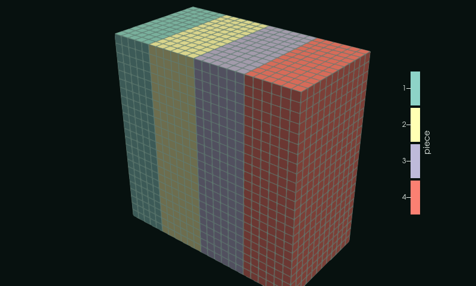
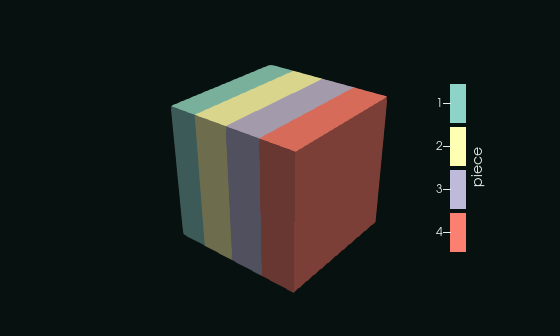
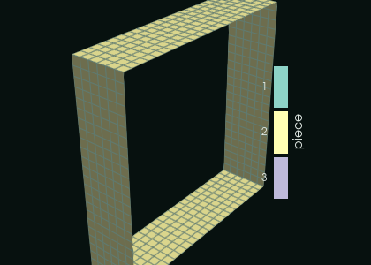
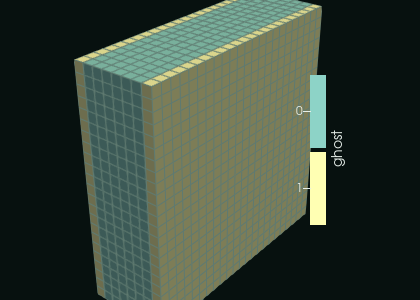

# 6. Going parallel

A parallel solver splits the mesh among its processes: each one writes its own **piece**, and one of them writes a small
header that lists the pieces. Here 4 pieces, split along x, as 4 processes would write them:

<<< @/examples/snippets/heat_6-pieces.f90

Each piece is a complete `.vtu` file, with its own points numbered from 0, plus one layer of **ghost cells** on each side:
the cells of the neighbours that a solver keeps to compute its own. They are marked in the `vtkGhostType` array (an
unsigned byte, 1 for a duplicate cell), so ParaView does not draw them twice.

<<< @/examples/snippets/heat_6-write.f90

The header declares the arrays of the pieces, their types and components, and lists the files:

<<< @/examples/snippets/heat_6-header.f90

The header and the pieces are written by different processes: a mismatch (an array missing in a piece, a different type)
makes readers drop arrays or fill them with zeros. `check_pieces` reads the header back and checks every piece:

<<< @/examples/snippets/heat_6-check.f90

::: details heat_6.f90
<<< @/examples/snippets/heat_6.f90
:::

## Running it

<<< @/examples/output/heat_6.ansi{ansi}

`heat.pvtu` in ParaView, coloured by the piece that owns each cell; the ghost cells are not drawn:

The pieces moved apart: each one is a complete file, with its own points.

Piece 2 alone, as ParaView draws it, and with its ghost cells drawn too: one layer of cells of each neighbour, marked 1
in `vtkGhostType` and drawn by the pieces that own them.

| | |
|---|---|
|  |  |
| the cells the piece owns | with its ghost cells (`vtkGhostType` = 1) |

::: tip What you learned
Each process writes its piece with `vtk_file`, one writes the header with `pvtk_file`; ghost cells are marked with
`write_dataarray_unsigned`; `check_pieces` verifies the result. Reference:
[Parallel Unstructured Grid](/guide/parallel#parallel-unstructured-grid-pvtu), [Parallel headers](/guide/reading#parallel-headers).
:::

Next: [7. An assembly](./07-assembly).
